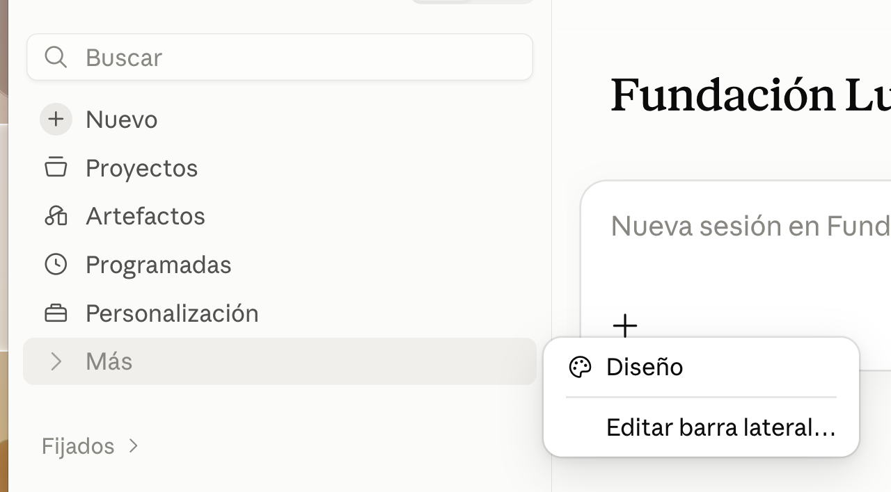
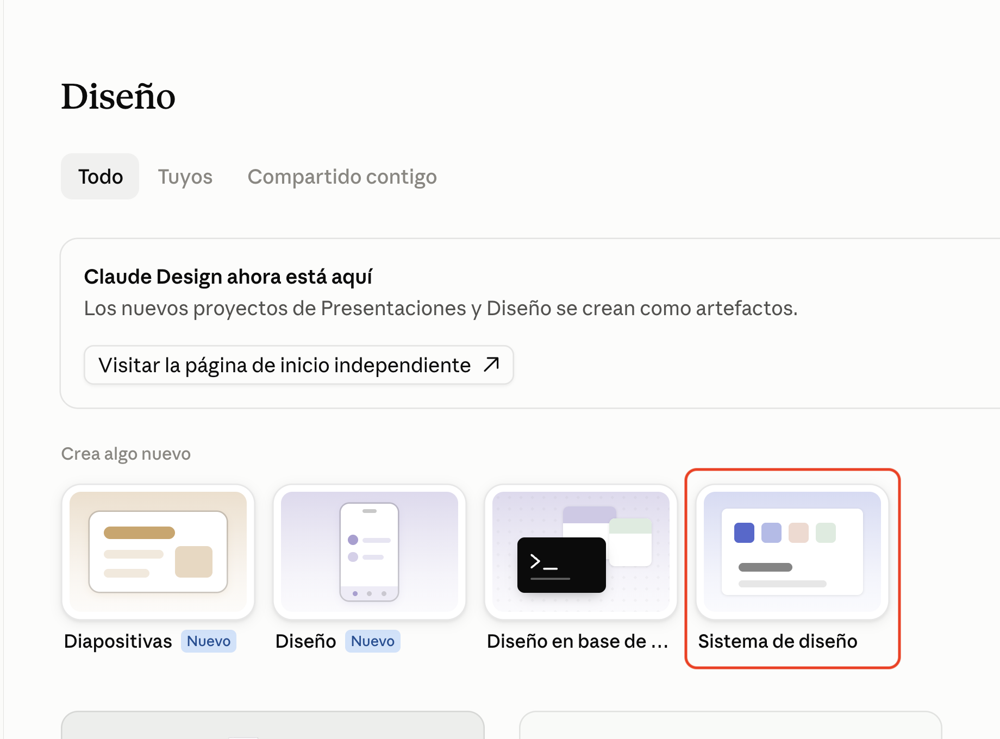

# Design

Lo primero que vamos a hacer es crear un tema y después un diseño.

Aquí hay varias formas de trabajar, por ejemplo, nosotros tenemos una herramienta interna que llamamos Cesty, que directamente trabaja sobre código y conecta con Figma si hace falta, estamos trabajando para sacar una versión pública.

Una opción muy popular es usar Claude Design, que viene con la licencia de Claude, lo mejor para trabajar con esto es tirar de Claude Desktop.

Y para saltar a ese modo:



Si entramos aquí, mira jugando con un proyecto final como el de Memora de Lucia (la red social privada de fotos).

Como tiene generado el Tema.

**Mostrar**

Como tiene generado el flujo de pantallas.

**Mostrar**

Y ¿Este curro de donde ha partido? Leyendo de este repo

https://github.com/Luceir0/lab-final--memora/tree/main

Que para la parte de theme si ha sacado bastante, pero de flujo de ventanas impresiona.

# Vamos a crear el nuestro

Vamos a jugar con Claude Design, para que nos de tiempo a cubrirlo en esta sesión de 8 horas, vamos con un caso reducido:

Quiero montar un portal para gestionar el alquiler vacacional de una villa frente al mar.

Si le damos a crear un nuevo proyecto, Vamos a partir de ceer un sistema de diseño, para ello elegimos sistema de diseño en la página de diseño:



Y aquí nos da varias opciones:

- Es capaz de leer de un proyecto de Github, del código saca el sistema de diseño.

- Puede tira de conectores y por ejemplo leer de Figma.

- Podemos subir archivos de marca.

- Podemos tirar por el chat.

En el caso anterior tiramos de Github, en este vamos a tirar de chat.

Vamos a subirle un logo y poner este prompt.

**NO OLVIDAR SUBIR LOGO ./01-material/logo.png**

```
Quiero montar un  design system para un sitio web de una villa de Alquiler vacacional:

- Es una villa que está frente al mar.

- En cuanto a colores tematizado, algo mediterraneo, agradable y suave.

- Los fotos de la villa y las vistas al mar saclas de unsplash o servicio similar.

- De base de tecnología para maquetación y componentes voy a usar tailwind y shadcn

- El flujo y descripcion de cada página:
  - Llego a una página principal donde veo el nombre de la villa, una breve descripción así como su dirección y telefono de contacto, un carrusel de fotos muy bonito, las característiscas de la vivienda (habitaciones, cuartos de baño, wifi, aire acondicionado...), y un sitio para poder chequear disponibilidad, el tipico calendario de reservas (que se suelen ver dos meses en escritorio, en movil creo que uno), en el que ves que días están ocupados, eliges un rango de fechas y le das a reservar.

  - Una vez que le das a reservar vas a otra página donde se ve tu reserva en días (la puedes cambiar), y te pido los datos personales (tarjeta identidad, nombre, apellidos, telefono, email, numero de huespedes, peticiones especiales), y si la reserva tiene disponibilidad le indicamos que nos pondremos en contacto con esa persona.

  - Además de esto hay una página de contacto, donde un usuario puede rellenar un formulario de contacto para interesarse por algún tema, y también están los datos de contacto telefon e email de la persona que gestiona el alquiler.


Primero quiero el theme, despues iremos a por páginas y flujo
```

Siguiente paso, vamos a crear las ventans y sus flujos, para version escriotorio y movil, esto lo hemos definido ya antes a ver que tal sale.

```
Perfecto, vamos ahora a por las diferentes ventanas, versión escritorio y móvil, y el flujo
```

Esto se lleva un buen rato.

Aquí es donde uno piensa y el ahora que hago:

- Una opción es desconectar y enfriar la cabeza (te hará falta a veces), te puedes poner antes un "/remote" y ver como evoluciona esto

- Otra opcíon en dejar esto funcionando, y mientras saltar a otras tareas, tener un aviso (mismo /remote o en otro minitor)

Vemos lo que ha generado, y en otro proyecto iríamos refinando, para este ejemplo va bien, fijate que podemos darle al play y probar el flujo.

- En esta tirada me pregunta ahora si va a por modo osucro, y estado de error, sería interesante crearlo pero puede llevar más de 10 minutos, así que lo vamos a de dejar aquí, y seguiría refinando, puede merecer la pena

Esto de aquí es editable tanto a nivel de prompt como a nivel de elementos, de hecho en la parte derecha arriba (donde está el zoom y el play, podemos mostrar las propiedades del elemento que estemos editando).

\*\* No vamos a jugar más con Claude Design pero es algo muy interesante, vamos ahora a implementar.
